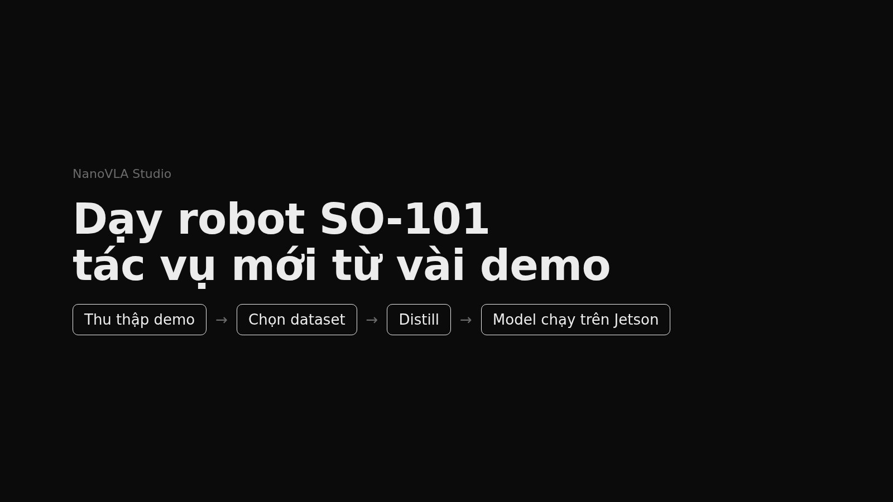
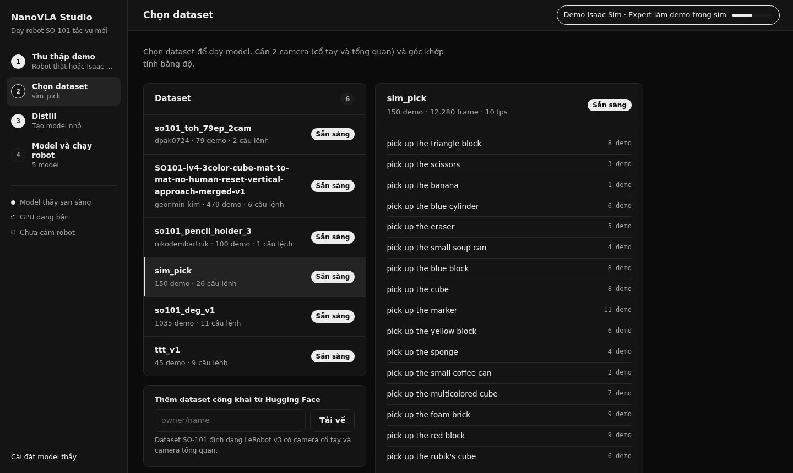
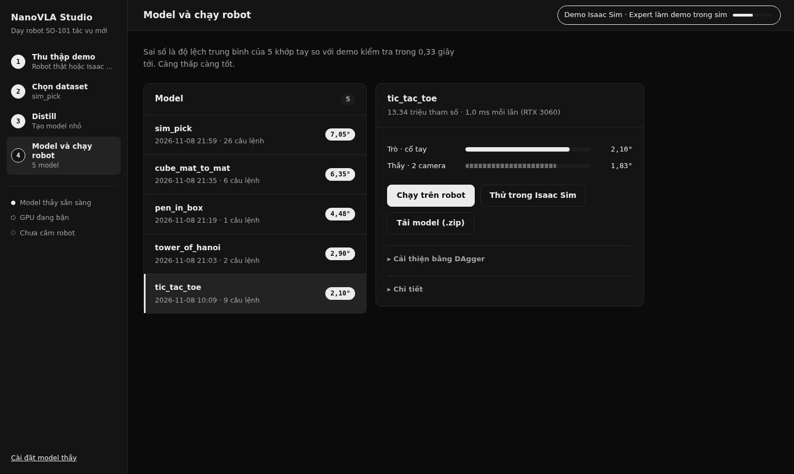
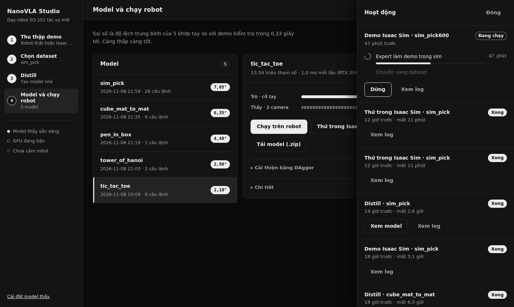

# NanoVLA Studio

Teach a **SO-101** arm a new task from a handful of demonstrations, and get a small model that runs on a
**Jetson Orin Nano** with only the wrist camera.



```
collect demos  ──>  pick a dataset  ──>  Distill  ──>  student.onnx  ──>  robot / Jetson
  (real robot or Isaac Sim)              │
                                         ├─ few-shot the SmolVLA teacher (450M, wrist + overview camera)
                                         ├─ the teacher labels every frame (+ augmented copies)
                                         └─ train the wrist-only student (ResNet18, 13M parameters, ~1 ms)
```

Everything runs from one web app: record demos, choose a dataset, press **Distill**, download or run the model.

| Choose a dataset | Models | Background jobs |
|---|---|---|
|  |  |  |

## Install and run

```bash
./setup.sh                                          # envs/lerobot (lerobot[smolvla]==0.4.4), envs/deploy, SmolVLA weights
envs/lerobot/bin/python -m app.server --port 8092   # open http://localhost:8092
```

The teacher checkpoint is expected at `ckpt/smolvla_deg/checkpoints/020000/pretrained_model`. Build one from the
**Cài đặt model thầy** page: it picks public SO-101 datasets recorded in degrees, merges them and fine-tunes
`lerobot/smolvla_base` (about 6 h on an RTX 3060). The interface is in Vietnamese.

1. **Collect**: with the leader arm on the real robot (wrist + overview camera, 30 fps, `use_degrees=True`), or let the
   scripted expert record demos in the Isaac Sim tabletop (joint angles converted to degrees).
2. **Dataset**: recorded datasets, or any public SO-101 LeRobot v3 dataset from the Hub.
3. **Distill**: one click. One demo per instruction is held out for testing.
4. **Model**: compare student and teacher, run on the robot, test in Isaac Sim, improve with DAgger, download a `.zip`.

On the robot without the app:

```bash
python deploy/run_student.py --onnx models/<name>/student.onnx --meta models/<name>/meta.json \
    --task "<instruction>" --port /dev/ttyACM0 --robot_id so101 --wrist_cam 0
```

## Results

Offline, on held-out demos of public SO-101 datasets. The numbers are the mean absolute error of the 5 arm joints,
in degrees, over the next 10 actions (0.33 s):

| Task | Train demos | Teacher (2 cameras, 42 ms) | Student (wrist, 1 ms) |
|---|---|---|---|
| tic-tac-toe, 9 instructions | 35 | 1.83° | 2.10° |
| Tower of Hanoi | 56 | 2.80° | 2.90° |
| pen into the box | 40 | 2.98° | 4.48° |
| cube between mats, 6 instructions | 60 | 3.05° | 6.35° |

Few-shot scaling on tic-tac-toe (teacher): zero-shot 4.18°, 9 demos 2.39°, 18 demos 1.93°, 35 demos 1.83°.
The student comes close to the teacher where the teacher labels enough frames; with only 40–60 demos it is still behind.

Closed loop in Isaac Sim (pick an object among 26 kinds, 150 scripted demos): the student succeeds in 3/24 trials and
the teacher in 2/24. A run with 600 demos and a longer few-shot is in progress. These are early numbers, not a finished
benchmark.

## Layout

```
app/        web app (server.py + static/index.html)
nanovla/    pipeline.py (jobs), teacher.py (SmolVLA eval / labels), student.py, merge.py, hub.py, sim_server.py
deploy/     run_student.py (robot loop, ONNX Runtime / TensorRT)
research/   earlier from-scratch models, the Isaac Lab tabletop benchmark, experiments
data/ ckpt/ models/ jobs/ envs/   local, not versioned
```

Built on [LeRobot](https://github.com/huggingface/lerobot), [SmolVLA](https://huggingface.co/lerobot/smolvla_base),
Isaac Sim / Isaac Lab, and public SO-101 datasets from the Hugging Face Hub (credited in `nanovla/hub.py` output and in
each model's `report.json`).
